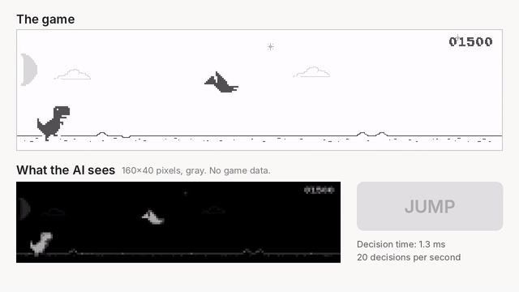
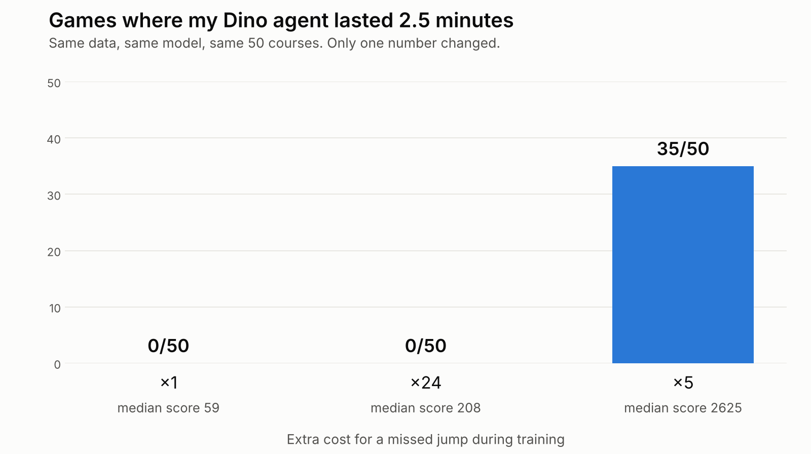
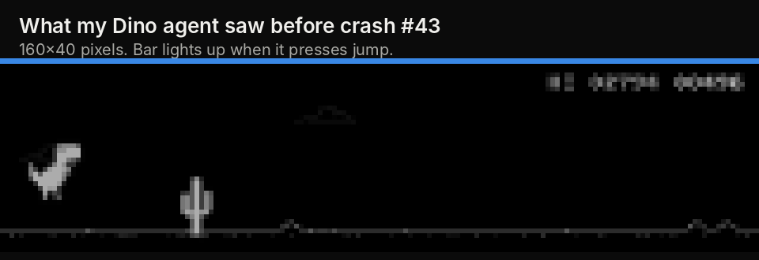

# pixels-to-keys

A Chrome Dino agent that acts from raw screen pixels, trained by behavior cloning on my own gameplay. The agent sees 160×40 grayscale frames, presses one key, and has no access to game state.



Full demo: [docs/demo.mp4](docs/demo.mp4)

## Approach

- **Data:** 30 rounds of human play (~24 min, 28k frames) recorded at 20 Hz. Only 4% of frames contain a jump.
- **Policy:** a small CNN (3 conv layers, ~220k parameters) over the last 4 frames. Output: jump or no-op. Inference takes ~1 ms on a laptop.
- **Training:** behavior cloning with weighted cross-entropy. The label for frames `t-3..t` is the key pressed right after `t`. Train/val are split by round.
- **Evaluation:** a deterministic copy of the game ([`env.py`](pixels_to_keys/env.py)) with a controlled clock and seeded courses. Every model plays the same 50 courses and gets the same score on any machine.

## Results

Same data, same architecture, same 50 courses. Only the loss weight on the jump class changes.

| Jump-class weight | Games lasting 5 min (of 50) | Games lasting 2.5 min (of 50) | Median score |
|---|---|---|---|
| 1 | 0 | 0 | 59 |
| 24 (inverse class frequency) | 0 | 0 | 208 |
| **5** | **26** | **35** | **5551 (cap)** |



### Failure analysis

Every evaluation game saves a clip of the last 2 seconds before the crash.



With weight 24, most crashes were the dino landing on wide cactus groups. To measure this, [`analyze.py`](pixels_to_keys/analyze.py) computes the obstacle distance at the moment of each jump, from pixels, for both human and agent:

| Speed | Human | Agent, weight 24 | Agent, weight 5 |
|---|---|---|---|
| Slow | 18 px | 30 px | 26 px |

Inverse-frequency weighting pushes the decision threshold down, so the policy fires as soon as a jump is slightly likely, which is several frames too early. Weight 1 has the opposite problem and fires too late.

Remaining failures with weight 5: occasional early jumps on wide groups at low speed, and late jumps at high speed. Human data at high speed is scarce (~15% of jumps).

## Usage

```bash
python -m venv .venv && source .venv/bin/activate
pip install -r requirements.txt
python -m playwright install chromium

# evaluate the included checkpoint on 50 fixed courses
python -m pixels_to_keys.evaluate --model checkpoints/dino.pt

# record your own play, train, evaluate
python -m pixels_to_keys.record --out data/dino
python -m pixels_to_keys.train --data data/dino --out checkpoints/dino.pt --jump-weight 5
python -m pixels_to_keys.evaluate --watch

# compare human vs agent jump timing
python -m pixels_to_keys.analyze --human data/dino --agent runs/dino/games --plot runs/jump_timing.png
```

## Project layout

```
pixels_to_keys/
  env.py           deterministic Dino environment: controlled clock, seeded courses
  browser.py       serve the Dino game, read frames, key presses and game state
  model.py         CNN policy
  record.py        record human demonstrations
  train.py         behavior cloning
  evaluate.py      fixed-seed evaluation, per-game rollouts and crash clips
  analyze.py       jump-timing analysis (human vs agent)
game/              Chrome's offline Dino game
checkpoints/       trained model
docs/              demo and figures
```

## Credits

Copy of Chrome's offline Dino game from [wayou/t-rex-runner](https://github.com/wayou/t-rex-runner), BSD-3-Clause ([game/LICENSE](game/LICENSE)).
