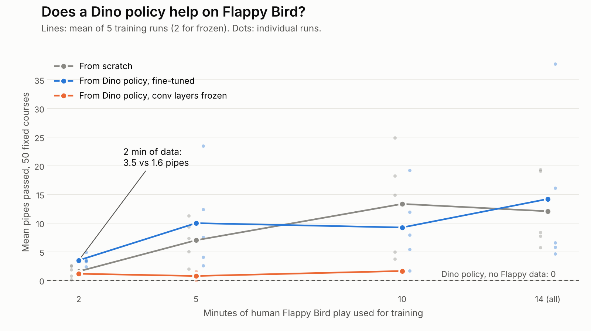

# pixels-to-keys

A Chrome Dino agent that acts from raw screen pixels, and a test of whether what it learned transfers to Flappy Bird. The agent sees 160×40 grayscale frames, presses one key, and has no access to game state.


Full demo: [docs/demo.mp4](docs/demo.mp4)

## Approach

- **Data:** 30 rounds of human play (~24 min, 28k frames) recorded at 20 Hz. Only 4% of frames contain a jump.
- **Policy:** a small CNN (3 conv layers, ~220k parameters) over the last 4 frames. Output: jump or no-op. Inference takes ~1 ms on a laptop.
- **Training:** behavior cloning with weighted cross-entropy. The label for frames `t-3..t` is the key pressed right after `t`. Train/val are split by round.
- **Evaluation:** a deterministic copy of the game ([`envs/dino.py`](pixels_to_keys/envs/dino.py)) with a controlled clock and seeded courses. Every model plays the same 50 courses and gets the same score on any machine.

## Results

Same data, same architecture, same 50 courses. Only the loss weight on the jump class changes.

| Jump-class weight | Games lasting 5 min (of 50) | Games lasting 2.5 min (of 50) | Median score |
|---|---|---|---|
| 1 | 0 | 0 | 59 |
| 24 (inverse class frequency) | 0 | 0 | 208 |
| **5** | **26** | **35** | **5551 (cap)** |


### Failure analysis

Every evaluation game saves a clip of the last 2 seconds before the crash.


With weight 24, most crashes were the dino landing on wide cactus groups. To measure this, [`analyze.py`](pixels_to_keys/analyze.py) computes the obstacle distance at the moment of each jump, from pixels, for both human and agent:

| Speed | Human | Agent, weight 24 | Agent, weight 5 |
|---|---|---|---|
| Slow | 18 px | 30 px | 26 px |

Inverse-frequency weighting pushes the decision threshold down, so the policy fires as soon as a jump is slightly likely, which is several frames too early. Weight 1 has the opposite problem and fires too late.

Remaining failures with weight 5: occasional early jumps on wide groups at low speed, and late jumps at high speed. Human data at high speed is scarce (~15% of jumps).

## Transfer to Flappy Bird

Does the Dino policy help on a game it has never seen? Flappy Bird ([FlapPyBird](https://github.com/sourabhv/FlapPyBird), unmodified) uses the same observation format and the same single action, but the dynamics are opposite: in Dino, doing nothing is safe; in Flappy Bird, doing nothing means falling.

Setup: 17 minutes of my own Flappy Bird play (126 rounds, median 4 pipes). For each amount of training data, three models are trained and evaluated on the same 50 fixed courses:

- **From scratch**
- **From the Dino policy, fine-tuned:** all weights updated
- **From the Dino policy, conv layers frozen:** only the head is trained



| Training data | From scratch | From Dino, fine-tuned | From Dino, conv frozen |
|---|---|---|---|
| none | – | 0.0 | – |
| 2 min | 1.6 | **3.5** | 1.2 |
| 5 min | 7.0 | 10.0 | 0.8 |
| 10 min | 13.4 | 9.2 | 1.6 |
| 14 min (all) | 12.1 | 14.2 | – |

Mean pipes passed, averaged over 5 training runs (2 for frozen).

- **Zero-shot, the Dino policy scores 0.** It waits for an obstacle, and the bird falls.
- **With 2 minutes of data, starting from Dino roughly doubles the score.** Its worst run beats 3 of 5 scratch runs (one-sided Mann-Whitney p = 0.016).
- **With 5 minutes or more, there is no measurable difference** (p = 0.69 at each size). Run-to-run variance is large: the same setup ranges from 4 to 38.
- **Frozen Dino features do not work.** The visual features have to be retrained to see pipes and gaps.

The Dino policy is not useful on Flappy Bird as it is, but it is a better starting point when new data is scarce.

## Usage

```bash
python -m venv .venv && source .venv/bin/activate
pip install -r requirements.txt
python -m playwright install chromium

# evaluate the included checkpoint on 50 fixed courses
python -m pixels_to_keys.evaluate --game dino --model checkpoints/dino.pt

# record your own play, train, evaluate
python -m pixels_to_keys.record --game dino --out data/dino
python -m pixels_to_keys.train --data data/dino --out checkpoints/dino.pt --jump-weight 5
python -m pixels_to_keys.evaluate --game dino --watch

# Flappy Bird: record, then run the transfer experiment
python -m pixels_to_keys.record --game flappy --out data/flappy
experiments/flappy_transfer.sh data/flappy

# compare human vs agent jump timing (Dino)
python -m pixels_to_keys.analyze --human data/dino --agent runs/dino/games --plot runs/jump_timing.png
```

## Project layout

```
pixels_to_keys/
  envs/dino.py     deterministic Dino environment: controlled clock, seeded courses
  envs/flappy.py   deterministic Flappy Bird environment
  browser.py       serve the Dino game, read frames, key presses and game state
  model.py         CNN policy
  record.py        record human demonstrations
  train.py         behavior cloning (optionally from pretrained weights)
  evaluate.py      fixed-seed evaluation, per-game rollouts and crash clips
  analyze.py       jump-timing analysis (human vs agent)
games/dino/        Chrome's offline Dino game
games/flappy/      FlapPyBird game code and sprites
checkpoints/       trained models
experiments/       transfer experiment script and plot
docs/              demo and figures
```

## Credits

- Dino: copy of Chrome's offline Dino game from [wayou/t-rex-runner](https://github.com/wayou/t-rex-runner), BSD-3-Clause ([games/dino/LICENSE](games/dino/LICENSE)).
- Flappy Bird: [FlapPyBird](https://github.com/sourabhv/FlapPyBird), MIT ([games/flappy/LICENSE](games/flappy/LICENSE)).
